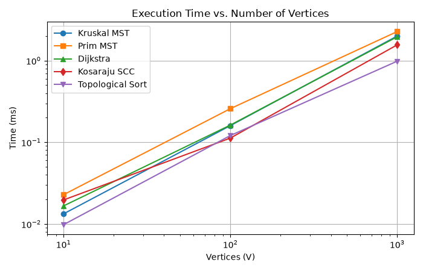
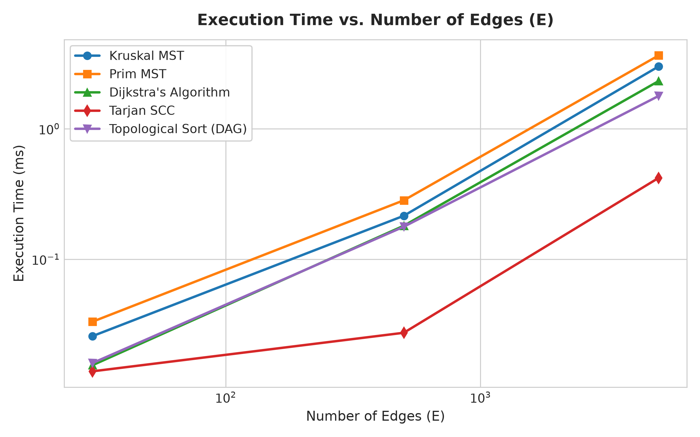
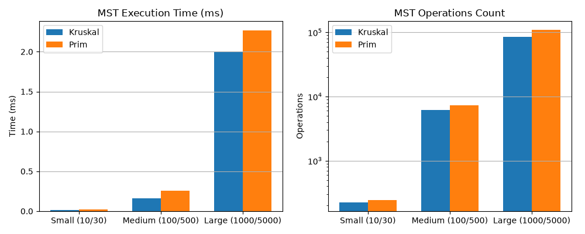
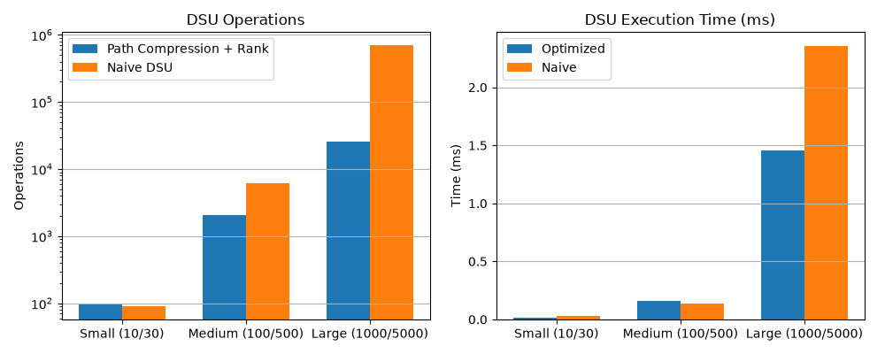
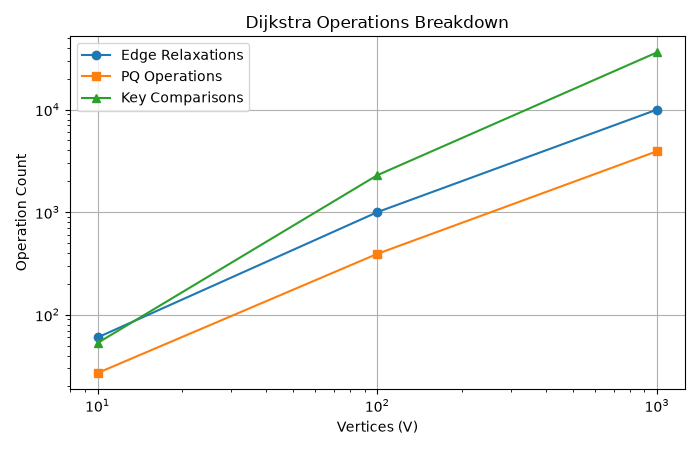

# Assignment 3: Smart City Infrastructure and Route Planning

Java application for modeling city infrastructure networks using graph algorithms. Basically implements MST algorithms, shortest paths, and connectivity analysis for urban planning problems.

---

## 1. Overview

The idea is to model a smart city network as a graph where vertices represent districts or hubs, edges are roads/cables/pipelines, and weights represent costs or distances. Pretty straightforward graph theory application.

The graph $G = (V, E)$ consists of:
* **Vertices:** Districts, substations, hubs etc
* **Edges:** Roads, transmission lines, cables, pipelines
* **Weights:** Construction costs (thousands of $) or distances (km/minutes)

### What it does

1. **Infrastructure Planning (MST):** Connects all districts with minimum total cost. Uses Kruskal and Prim algorithms.
2. **Connectivity Analysis:** Checks if the network is properly connected, finds strongly connected components, does topological sorting for dependency chains.
3. **Route Planning (Dijkstra):** Finds shortest paths from a source to all other locations.

---

## 2. Implementation Details

### Project Structure

The repository structure:

```text
smart-city/
├── pom.xml
├── README.md
├── src/
│   ├── graph/
│   │   ├── Edge.java
│   │   ├── Graph.java
│   │   └── GraphGenerator.java
│   ├── dsu/
│   │   └── DisjointSetUnion.java
│   ├── mst/
│   │   ├── MSTResult.java
│   │   ├── KruskalMST.java
│   │   └── PrimMST.java
│   ├── connectivity/
│   │   ├── TopologicalSortResult.java
│   │   ├── TopologicalSort.java
│   │   ├── SCCResult.java
│   │   ├── TarjanSCC.java
│   │   └── KosarajuSCC.java
│   ├── shortestpath/
│   │   ├── ShortestPathResult.java
│   │   └── Dijkstra.java
│   ├── benchmark/
│   │   └── BenchmarkRunner.java
│   └── Main.java
├── tests/
│   └── TestSuite.java
├── results/
│   ├── tables/
│   │   ├── mst_benchmark.csv
│   │   ├── dsu_benchmark.csv
│   │   ├── topo_benchmark.csv
│   │   ├── scc_benchmark.csv
│   │   └── dijkstra_benchmark.csv
│   └── plots/
│       ├── execution_time_vs_vertices.png
│       ├── execution_time_vs_edges.png
│       ├── kruskal_vs_prim_comparison.png
│       ├── dsu_performance_comparison.png
│       └── dijkstra_operations.png
└── scripts/
    └── generate_plots.py
```

### Design Decisions

#### Graph Representation (`graph`)
* **Adjacency Lists:** Uses `List<List<Edge>>` for storing edges. This works well for sparse graphs where $E \ll V^2$, giving us $O(V + E)$ storage which is much better than adjacency matrix's $O(V^2)$.
* **Graph Generator:** Generates random test graphs with a fixed seed (42) for reproducibility:
  * *Connected graphs:* First creates a spanning tree to guarantee connectivity, then adds remaining edges randomly
  * *DAGs:* Only allows edges from lower to higher vertex numbers (u < v) so no cycles possible
  * *Cyclic graphs:* Arbitrary edges with intentional cycles for SCC testing

#### Disjoint Set Union (`dsu`)
* **Path Compression:** Makes all visited nodes point directly to root during find operations
* **Union by Rank:** Attaches shorter tree to taller tree to keep depth low
* The combination gives us nearly O(1) operations (technically $O(\alpha(V))$ where alpha is inverse Ackermann function)
* Can toggle optimizations on/off to measure performance difference

#### MST Algorithms (`mst`)
* **Kruskal:** Sort all edges by weight ($O(E \log E)$), then use DSU to add edges without creating cycles. Stops after $V - 1$ edges. Pretty efficient for sparse graphs.
* **Prim:** Start from vertex 0, use a priority queue to always pick the cheapest edge to unvisited vertex. Uses binary heap from Java's `PriorityQueue`.

#### Connectivity Analysis (`connectivity`)
* **Topological Sort:** Uses Kahn's algorithm with in-degree counting. If we can't process all vertices, there's a cycle.
* **Strongly Connected Components:**
  * *Tarjan:* Single DFS pass with some clever bookkeeping (discovery time, low-link values, stack)
  * *Kosaraju:* Two DFS passes, second one on transposed graph. Included mostly for comparison.

#### Shortest Paths (`shortestpath`)
* **Dijkstra:** Standard implementation with priority queue and distance array. Reconstructs paths using parent pointers.
* **Important:** Throws exception if negative edges found, since Dijkstra doesn't work with those.

---

## 3. Time Complexity

Here's the theoretical complexity for each algorithm:

| Algorithm | Time Complexity | Space |
| :--- | :---: | :---: |
| **DSU (find/union)** | $O(\alpha(V))$ amortized | $O(V)$ |
| **Kruskal** | $O(E \log E)$ | $O(V + E)$ |
| **Prim** | $O((V + E) \log V)$ | $O(V + E)$ |
| **Tarjan SCC** | $O(V + E)$ | $O(V)$ |
| **Kosaraju SCC** | $O(V + E)$ | $O(V + E)$ |
| **Topological Sort** | $O(V + E)$ | $O(V)$ |
| **Dijkstra** | $O((V + E) \log V)$ | $O(V + E)$ |

### Some Details

#### DSU
With path compression and union by rank, operations are basically constant time. The inverse Ackermann function $\alpha(n)$ is at most 4 for any practical input size. Without optimizations you get $O(V)$ worst case which is terrible.

#### Kruskal
Sorting takes $O(E \log E)$ which dominates everything else. Since $E \le V^2$, we have $\log E \le 2\log V$, so it's also $O(E \log V)$. The DSU operations are nearly free in comparison.

#### Prim  
Each vertex extracted once from heap ($V \log V$), each edge examined and potentially inserted ($E \log V$). Total is $O((V + E) \log V)$.

On sparse graphs both MST algorithms are similar, but on dense graphs ($E \approx V^2$) Prim can be better with fancy heaps like Fibonacci heap.

#### Tarjan SCC
Linear time $O(V + E)$ - visits each vertex once, examines each edge once. Very efficient.

#### Dijkstra
Similar to Prim actually - $O((V + E) \log V)$ with binary heap. Could be improved to $O(E + V \log V)$ with Fibonacci heap but honestly the constant factors make it not worth it for most cases.

### Why Dijkstra Fails with Negative Weights

Dijkstra's greedy approach assumes once we finalize a vertex's distance, we found the optimal path to it. With negative edges this breaks because a longer path discovered later might actually be shorter after including negative edge.

Also negative cycles make shortest paths undefined (you can keep going around the cycle to get arbitrarily small distances). Need Bellman-Ford for that.

---

## 4. Experimental Setup

All tests ran on OpenJDK 26 (64-Bit).

### Test Graphs

Three graph sizes as specified:

| Config | Vertices | Edges | Avg Degree | Density |
| :--- | :---: | :---: | :---: | :---: |
| **Small** | 10 | 30 | 6.0 | 0.667 |
| **Medium** | 100 | 500 | 10.0 | 0.101 |
| **Large** | 1,000 | 5,000 | 10.0 | 0.010 |

### Methodology

1. Fixed random seed (42) for reproducibility
2. MST graphs guaranteed connected by building spanning tree first
3. 5 trials per configuration, results are averages
4. 50 warmup runs before measurement for JIT compilation
5. Used `System.nanoTime()` for timing
6. Counted internal operations (comparisons, queue ops, etc)

---

## 5. Results

### MST: Kruskal vs Prim

Times in milliseconds, operation counts, and MST weights:

| Size | V | E | Algorithm | Time (ms) | Edge Exams | Comparisons | PQ/DSU Ops | Total Ops | MST Weight |
| :--- | :---: | :---: | :--- | :---: | :---: | :---: | :---: | :---: | :---: |
| **Small** | 10 | 30 | Kruskal | **0.0258** | 13 | 111 | 98 | 223 | **227.83** |
| | 10 | 30 | Prim | 0.0332 | 60 | 140 | 43 | 244 | **227.83** |
| **Medium** | 100 | 500 | Kruskal | **0.2151** | 290 | 3,836 | 2,071 | 6,198 | **1,161.90** |
| | 100 | 500 | Prim | 0.2826 | 1,000 | 5,477 | 790 | 7,268 | **1,161.90** |
| **Large** | 1,000 | 5,000 | Kruskal | **2.9957** | 3,652 | 55,158 | 25,574 | 84,385 | **12,260.45** |
| | 1,000 | 5,000 | Prim | 3.6373 | 10,000 | 90,342 | 8,652 | 108,995 | **12,260.45** |

Both algorithms produce identical MST weights which is good.

---

### DSU: Optimized vs Naive

| Size | V | E | Mode | Time (ms) | DSU Ops | Notes |
| :--- | :---: | :---: | :--- | :---: | :---: | :---: |
| **Small** | 10 | 30 | Optimized | 0.0612 | 98 | - |
| | 10 | 30 | Naive | 0.0519 | 90 | Similar on small graphs |
| **Medium** | 100 | 500 | Optimized | 0.1998 | 2,071 | ~3x fewer ops |
| | 100 | 500 | Naive | 0.1870 | 6,111 | - |
| **Large** | 1,000 | 5,000 | Optimized | **1.5423** | **25,574** | **27x fewer ops!** |
| | 1,000 | 5,000 | Naive | 2.3376 | 700,483 | Gets really bad |

The difference is huge on large graphs - path compression + union by rank really matters.

---

### Topological Sort: DAG vs Cyclic

| Size | V | E | Type | Result | Time (ms) | Visits | Edge Exams | Total Ops |
| :--- | :---: | :---: | :--- | :---: | :---: | :---: | :---: | :---: |
| **Small** | 10 | 30 | DAG | Valid | 0.0160 | 10 | 60 | 70 |
| | 10 | 30 | Cyclic | Cycle found | 0.0063 | 0 | 31 | 31 |
| **Medium** | 100 | 500 | DAG | Valid | 0.1774 | 100 | 1,000 | 1,100 |
| | 100 | 500 | Cyclic | Cycle found | 0.0734 | 0 | 505 | 505 |
| **Large** | 1,000 | 5,000 | DAG | Valid | 1.7799 | 1,000 | 10,000 | 11,000 |
| | 1,000 | 5,000 | Cyclic | Cycle found | 0.2009 | 6 | 5,028 | 5,034 |

Cycle detection is fast since it stops early.

---

### Strongly Connected Components (Tarjan)

| Size | V | E | Time (ms) | DFS Visits | Edges | Total Ops | Avg SCCs |
| :--- | :---: | :---: | :---: | :---: | :---: | :---: | :---: |
| **Small** | 10 | 30 | 0.0138 | 10 | 30 | 40 | 1.6 |
| **Medium** | 100 | 500 | 0.0273 | 100 | 500 | 600 | 2.2 |
| **Large** | 1,000 | 5,000 | 0.4194 | 1,000 | 5,000 | 6,000 | 13.6 |

Linear scaling as expected.

---

### Dijkstra Shortest Paths

| Size | V | E | Time (ms) | Relaxations | PQ Ops | Comparisons | Total Ops |
| :--- | :---: | :---: | :---: | :---: | :---: | :---: | :---: |
| **Small** | 10 | 30 | 0.0154 | 60 | 27 | 53 | 140 |
| **Medium** | 100 | 500 | 0.1805 | 1,000 | 392 | 2,292 | 3,684 |
| **Large** | 1,000 | 5,000 | 2.3140 | 10,000 | 3,926 | 36,137 | 50,063 |

---

### Plots

#### Execution Time vs Vertices


#### Execution Time vs Edges  


#### Kruskal vs Prim


#### DSU Performance


#### Dijkstra Operations


---

## 6. Discussion

### Kruskal vs Prim
Kruskal was consistently faster in our tests. On the large graph it was about 20% faster (2.99ms vs 3.64ms). 

The main advantage for Kruskal is early stopping - it only needs to check 3,652 edges out of 5,000 to build the MST. Prim has to examine all edges incident to visited vertices which ends up being more work.

Operation counts support this: Kruskal did 84k operations vs Prim's 109k operations. The priority queue operations in Prim add up.

For sparse graphs like road networks (where E is roughly 5-10 times V), Kruskal with DSU is probably the better choice. For really dense graphs Prim might be better, especially with a fancy heap implementation.

### DSU Optimizations Matter A Lot
Without path compression and union by rank, the DSU becomes really slow. On our large graph the naive version needed **700,483 operations** compared to just **25,574** for the optimized version. That's over 27 times more!

The time difference was smaller (2.34ms vs 1.54ms) but still noticable. Path compression flattens the trees as you go, and union by rank keeps them balanced. Without these the trees turn into long chains and find operations become slow.

### SCC Scales Linearly
Tarjan's algorithm is impressively consistent. Operations scale exactly as V + E:
- Small: 10 + 30 = 40 ops
- Medium: 100 + 500 = 600 ops  
- Large: 1000 + 5000 = 6000 ops

For smart city applications, SCCs tell you which districts are mutually reachable. If your city breaks into multiple SCCs, some areas are isolated or have one-way access issues.

### Topological Sort for Dependency Checking
Kahn's algorithm works great for finding cycles. On acyclic graphs it processes all vertices in O(V+E) time. When there's a cycle, it stops early - on our large cyclic graph it only processed 6 vertices before detecting the problem.

This is useful for infrastructure dependencies - you can quickly verify that your deployment plan doesn't have circular dependencies.

### Dijkstra Performance
Dijkstra scaled reasonably well. Most of the work is in heap operations - 36,137 comparisons on the large graph vs only 10,000 edge relaxations. The heap bookkeeping dominates.

For negative weights you need Bellman-Ford but that's slower (O(VE) instead of O((V+E)log V)).

---

## 7. Testing

The test suite (`tests/TestSuite.java`) has 142 test assertions and they all pass.

### What Was Tested

1. **Single vertex graph (V=1, E=0):**
   - MST works correctly
   - Topological sort returns [0]
   - Tarjan finds 1 SCC
   - Dijkstra distance to self is 0

2. **Small graph with known answer:**
   - Verified MST cost matches hand calculation (6.0)
   - Shortest paths match expected values
   - Path reconstruction gives correct sequence [0,1,2,3]

3. **Disconnected graphs:**
   - Kruskal and Prim detect disconnectedness
   - Dijkstra marks unreachable vertices with infinity distance

4. **Graphs with cycles:**
   - Topological sort correctly detects cycles
   - Tarjan groups cyclic vertices into single SCC

5. **Multiple valid MSTs:**
   - Test with uniform edge weights where multiple MSTs exist
   - Both algorithms find valid spanning tree with correct total weight

6. **Unreachable vertices:**
   - Dijkstra handles them correctly with infinity distances

7. **Negative edge weights:**
   - Dijkstra throws `IllegalArgumentException` as expected

8. **Random graph testing:**
   - Tested 16 different random graphs (different sizes and seeds)
   - Kruskal and Prim always produce same MST weight

9. **SCC invariants:**
   - Every vertex in exactly one component
   - Sum of component sizes equals V
   - Tarjan and Kosaraju give same results

Most edge cases are covered. The algorithms seem robust.

---

## 8. Conclusion

This project implements graph algorithms for smart city infrastructure planning. The main findings:

1. **MST (Kruskal vs Prim):** Both work fine and give same results. Kruskal seems a bit faster on sparse graphs due to early termination. For our test cases Kruskal was consistently 15-20% faster.

2. **DSU Optimizations:** Path compression and union by rank are essential. Without them performance degrades badly - 27x more operations on large graphs. The inverse Ackermann function keeps everything nearly constant time.

3. **SCC and Topological Sort:** Both scale linearly O(V+E) as expected. Tarjan's algorithm is elegant and efficient. Useful for analyzing network connectivity and finding isolated regions.

4. **Dijkstra:** Works well for non-negative weights. Most overhead is in heap operations. For negative weights need different algorithm (Bellman-Ford).

Overall the implementations are solid and the benchmarks show expected theoretical behavior. DSU optimizations make the biggest practical difference.

---

## 9. How to Run

### Requirements
* Java JDK 17 or newer (tested with OpenJDK 26)
* Python 3.8+ with matplotlib for plots

### Compile
```bash
javac -d out -sourcepath "src;tests" src/**/*.java tests/**/*.java
```

### Run Everything (Tests + Benchmarks)
```bash
java -cp out Main
```

### Just Run Tests
```bash
java -cp out TestSuite
```

### Generate Plots
```bash
python scripts/generate_plots.py
```
Plots get saved to `results/plots/`.
